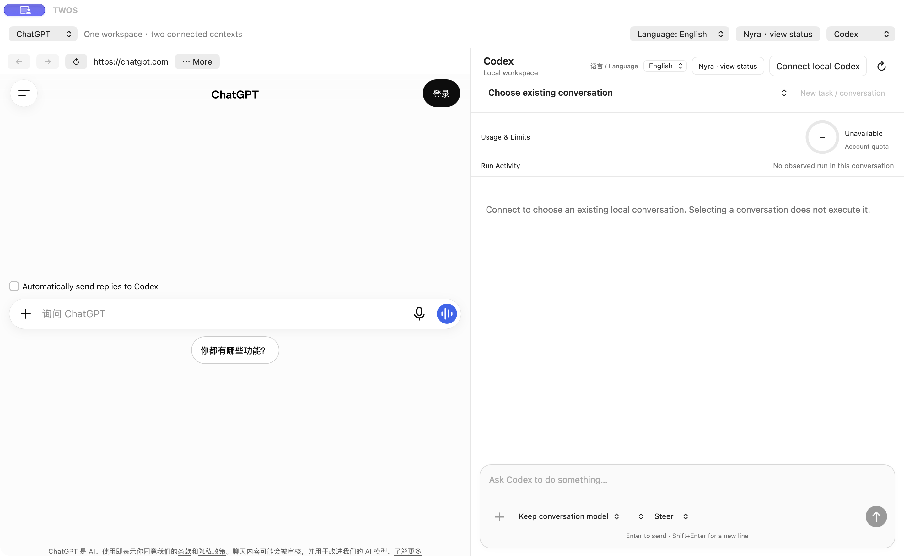

# Long-conversation connection repair

TWOS 1.0.8 / 101.56; Nyra 1.0.6 / 106 unchanged. The matching GitHub Release determines public download availability.

## Upgrade check

After installing the verified patch, open TWOS → Codex → Connect local Codex once. Select your existing conversation and confirm message history appears. Saved activity opens stored tool details in five-item pages. Disconnect and connect again only if needed. Do not send to the same conversation while the official app is executing it. No new task, directory selection or accepted business retest is needed.

## Evidence and limits

The Owner reported `invalid_or_oversized_jsonl` in 1.0.7 after selecting a long development conversation. The earlier connection gate used short engineering history and a 4 MB fragmented fixture; it did not cover this long-history restore path. Its original results remain historical evidence, not proof that this case worked.

The repaired client requests message summaries when opening a conversation. Run-status refresh requests turn metadata without items. **Saved activity → Load recent items / Older items** reads five stored items at a time, only when requested, without resuming the conversation or sending a task. Each activity page replaces the previous page. Live tool activity continues streaming. The service may not support saved-item paging for every conversation.

Oversized responses and invalid protocol messages now have separate errors. The 24 MB single-message safety bound remains; it is not removed or increased to absorb unbounded full history. If an individual item exceeds that bound, reconnect explicitly to restore the summary view. Never clear authentication, drafts or conversation data to work around this error. The currently active official development conversation is inspected read-only and must not be controlled simultaneously from TWOS.

Validation of the repair and its release status are recorded separately; this follow-up does not grant Owner acceptance.

## Matching validation

The exact signed, notarized package passed the complete serial gate: 1860 passed, 1 existing historical skip, 0 failures, including 38 real Safari measurements. The affected long conversation was restored read-only in the final DMG app; saved activity, models, conversation selection and disconnect/reconnect were observed. One new isolated, harmless message returned PATCH_108_HISTORY_OK in one turn, after an upstream transient reconnect. No old task was replayed. Nyra 1.0.6 / 106 is unchanged. Owner acceptance remains separate.

## Actual interface

Actual final-DMG starting screen with signed-out ChatGPT and disconnected Codex; no private conversation is shown. This image is interface evidence, not the long-history test result.
