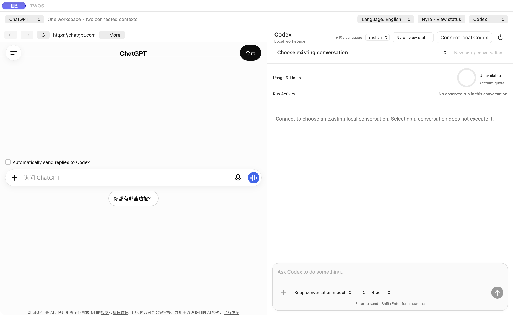

# 长会话连接修复

TWOS 1.0.8 / 101.56；Nyra 1.0.6 / 106 未改动。公开下载以对应 GitHub Release 为准。

## 升级增量检查

安装已验证补丁后，打开 TWOS → Codex → 连接本机 Codex 一次。选择原会话，确认消息历史显示；可展开“历史活动”按五项一页读取保存的工具详情。需要时才断开并重新连接。官方应用正在执行的同一会话不要从 TWOS 再发送。无需新建任务、重选目录或重测已通过业务。

## 证据与范围

Owner 在 1.0.7 选择较长研发会话后遇到 `invalid_or_oversized_jsonl`。上一轮连接门禁使用较短工程历史和约 4 MB 分片样本，遗漏了长会话恢复路径。原测试结果保留为历史证据，不能证明本次场景通过。

修复后的客户端打开会话时读取消息摘要；刷新运行状态只读取轮次元数据。**历史活动 → 读取最近活动／更早活动** 在用户点击后每次读取五项保存记录，每页替换上一页，不恢复会话、不发送任务。实时工具活动继续流式展示。部分会话可能不支持服务端历史活动分页。

超大响应和无效协议消息使用不同错误提示，保留单条 24 MB 安全边界，不通过取消或增大限制来承接无界完整历史。如果单项活动仍超过边界，请手动重连恢复摘要视图；不要清空登录、草稿或会话数据。官方客户端仍在执行的研发会话只读核验，不能同时由 TWOS 接管。

修复验证和发行状态另行记录，本追加说明不代表 Owner 接受。

## 匹配验证

精确签名公证包完成同一批串行完整回归：1860 通过、1 项既有历史跳过、0 失败，含 38 项真实 Safari 测量。最终 DMG 中的 App 已只读恢复原受影响长会话，并实际检查保存的活动、模型、会话选择及断开／重连。新隔离会话中的一条无害消息经历服务端临时重连后，在同一 turn 返回 PATCH_108_HISTORY_OK；未重放旧任务。Nyra 1.0.6 / 106 未改动，Owner 接受独立记录。

## 真实界面

最终 DMG 的实际起始界面：ChatGPT 未登录、Codex 未连接，不展示私人会话。此图说明界面，不代替长历史实测结果。
