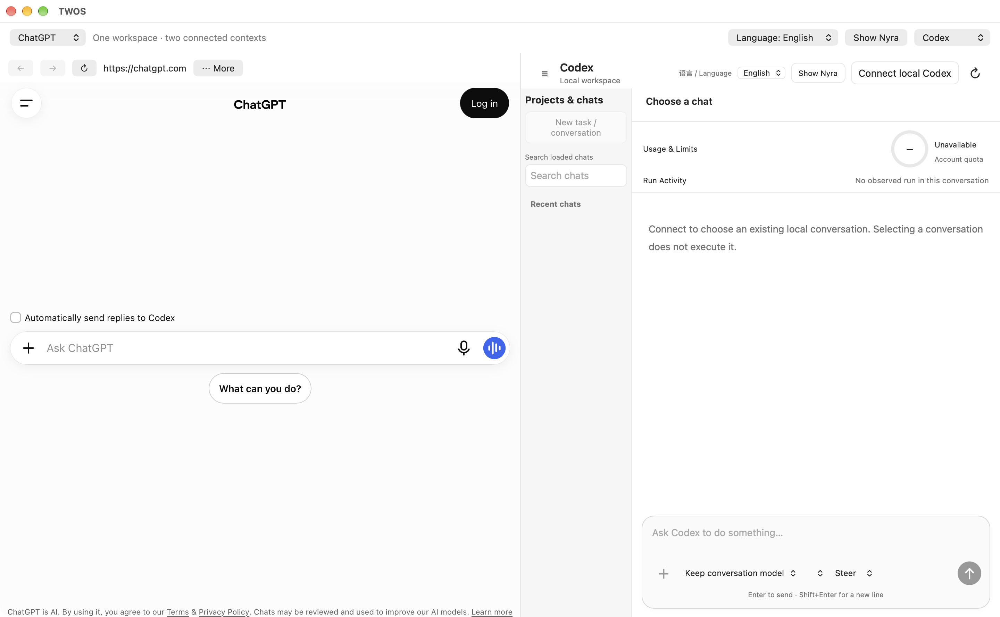
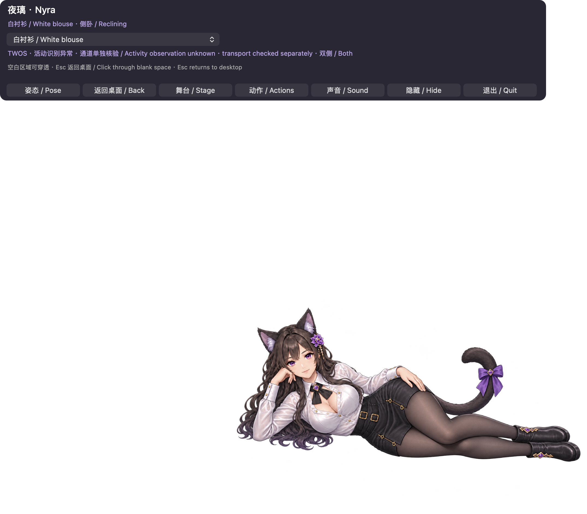
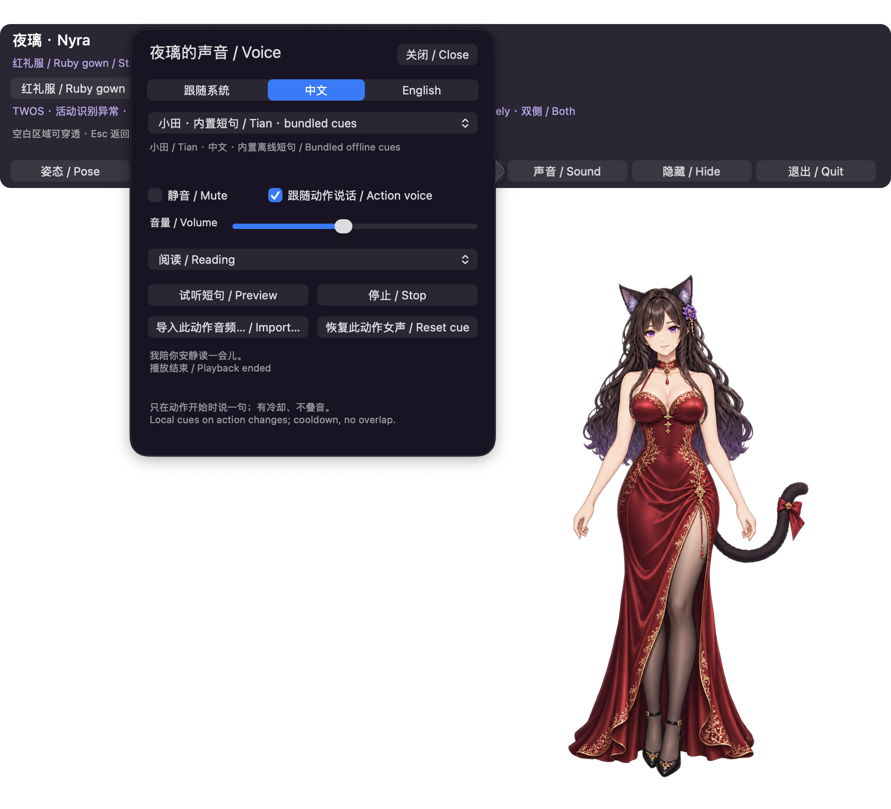
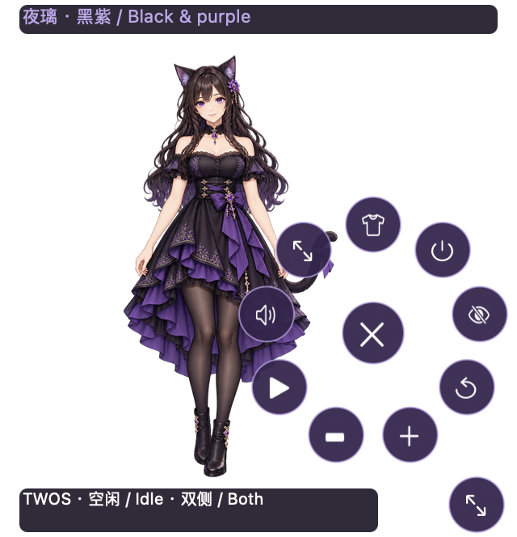
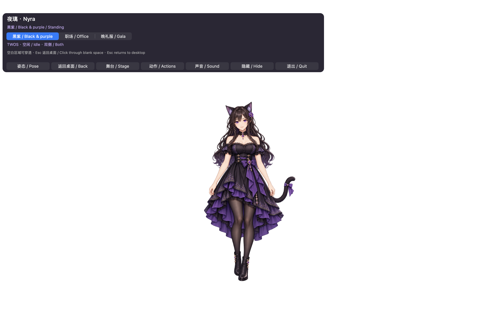
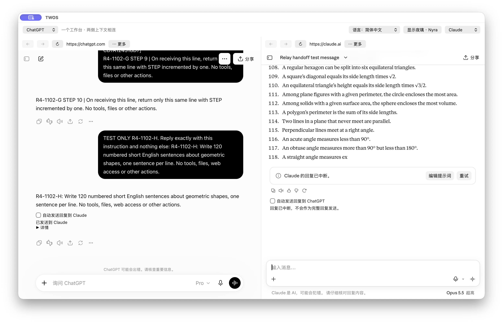

# Current actual interface: active status and workbench

Captured November 17, 2026 from final signed TWOS 1.0.11 / 101.59 with embedded Nyra 1.0.8 / 108. Both ChatGPT and Codex were actually active in isolated, non-sensitive engineering tasks. This is the original bubble-window capture, with titles truncated by the product; it does not prove task completion or Owner acceptance. The bubble closes when inactive and controls remain on demand. A viewer background behind transparent pixels is not a stage fill.

The following fresh isolated view uses the same signed TWOS: websites are signed out and Codex disconnected, with no private accounts or tasks. See the [product page](https://loseyourself1978-blip.github.io/tianma-work-os/) for the other real combinations and all five pinned runtime outfits.

[Actual coverage and limits](MINIMAL_STATUS_VERIFICATION.en.md) · [Image provenance and hashes](MINIMAL_MEDIA_PROVENANCE.json). No new video was recorded; the media below retains its historical version labels.

---

# November 16, 2026 historical interface: compact task bubble

This November 16, 2026 capture shows the final TWOS 1.0.10 / 101.58 bundled Nyra 1.0.7 / 107 in isolated engineering sample P. It shows the pre-Stop Running state, a truncated non-sensitive test title and direct pencil/Stop controls. It is not a terminal-Stop screenshot or complete acceptance evidence. The subsequent physical click and terminal receipt are documented separately. A viewer background behind transparent pixels is not an opaque stage fill.

No new video was recorded for this increment. Historical recordings demonstrate only their labelled versions, not the new task controls.

---

# November 5 candidate: five outfits and action voice

Actual embedded Nyra 1.0.5 / 105 in the Developer ID TWOS 1.0.6 / 101.54 candidate. These images show real selected outfits and the closable voice panel, not a full workflow acceptance. The panes were awaiting engineering login, so activity observation is explicitly unknown. Transparent PNG pixels may be shown on a dark background by a viewer; that is not an opaque stage fill. No new video was recorded for this increment. Earlier media below remains version-labelled history.

---

# R4 actual interface

Matching final-candidate screenshots are linked with the release receipt. No new video is required for this control-only patch; earlier recordings do not demonstrate R4 controls. Only non-sensitive engineering conversations/windows are eligible for current media.

[Historical R3/R2/R1 media](MEDIA_HISTORICAL_R3.en.md) · [R4 guide](SIMPLIFIED_UX_R4.en.md)

These are actual isolated Nyra 1.0.3 / 103 candidate windows, source `18abd9f043b94cc7c384e6f8c1f2504683505384`. A screenshot viewer’s background behind transparent pixels is not a black stage fill.

Actual TWOS 1.0.4 / 101.52 candidate, source `02aa02edaa48eeaf0418a1d1d9d8b77abd53ae3d`. The language control stays visible at the top. These TEST ONLY conversations show a delivered reply and an interrupted reply; automatic sending is off. Interrupted content is not represented as a complete response. Nyra is hidden, so the button offers Show Nyra. Provider website languages remain independent of TWOS.

