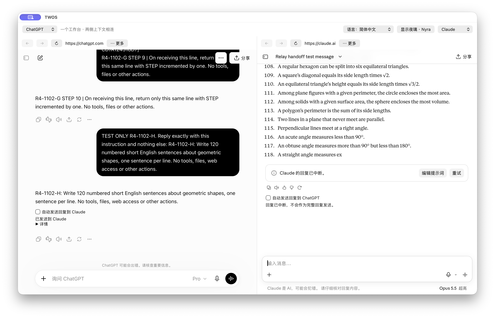

# R4 actual interface

Matching final-candidate screenshots are linked with the release receipt. No new video is required for this control-only patch; earlier recordings do not demonstrate R4 controls. Only non-sensitive engineering conversations/windows are eligible for current media.

[Historical R3/R2/R1 media](MEDIA_HISTORICAL_R3.en.md) · [R4 guide](SIMPLIFIED_UX_R4.en.md)

These are actual isolated Nyra 1.0.3 / 103 candidate windows, source `18abd9f043b94cc7c384e6f8c1f2504683505384`. A screenshot viewer’s background behind transparent pixels is not a black stage fill.

Actual TWOS 1.0.4 / 101.52 candidate, source `02aa02edaa48eeaf0418a1d1d9d8b77abd53ae3d`. The language control stays visible at the top. These TEST ONLY conversations show a delivered reply and an interrupted reply; automatic sending is off. Interrupted content is not represented as a complete response. Nyra is hidden, so the button offers Show Nyra. Provider website languages remain independent of TWOS.

