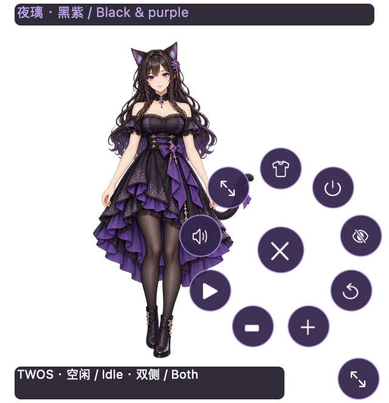
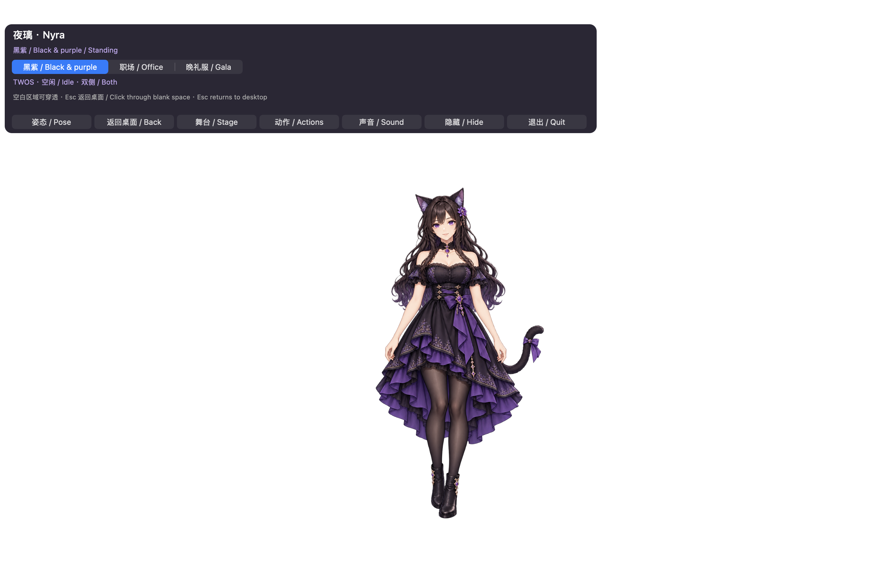

# R4 actual interface

Matching final-candidate screenshots are linked with the release receipt. No new video is required for this control-only patch; earlier recordings do not demonstrate R4 controls. Only non-sensitive engineering conversations/windows are eligible for current media.

[Historical R3/R2/R1 media](MEDIA_HISTORICAL_R3.en.md) · [R4 guide](SIMPLIFIED_UX_R4.en.md)

These are actual isolated Nyra 1.0.3 / 103 candidate windows, source `18abd9f043b94cc7c384e6f8c1f2504683505384`. A screenshot viewer’s background behind transparent pixels is not a black stage fill.

