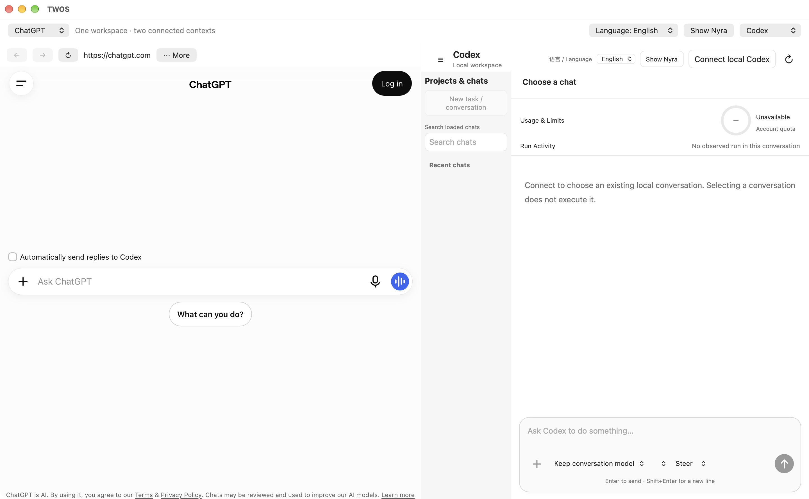
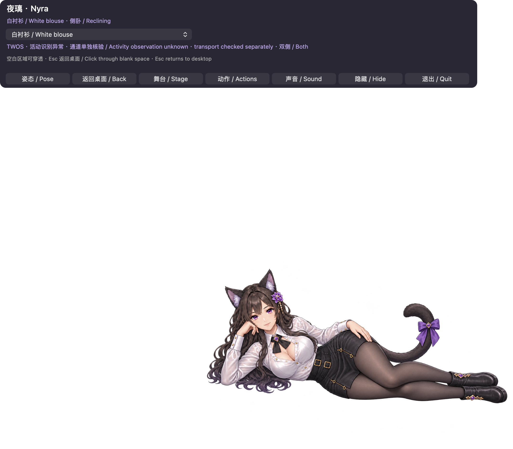
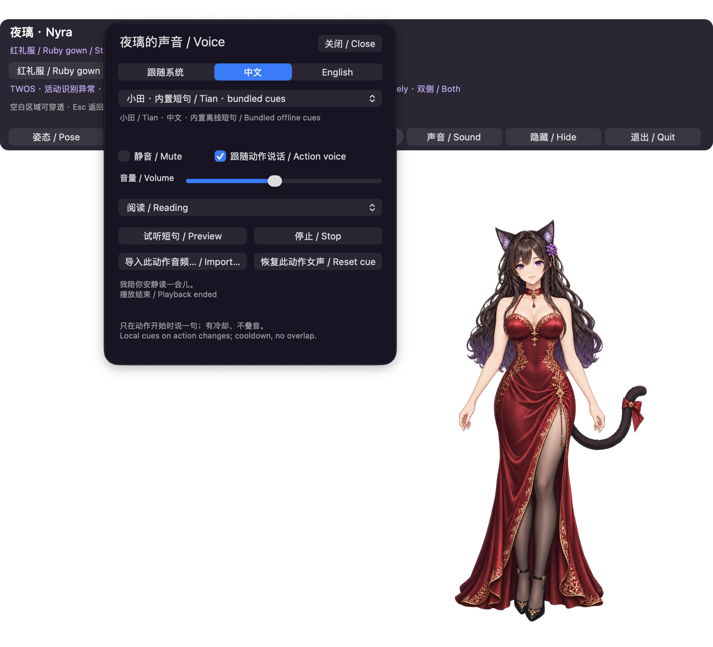
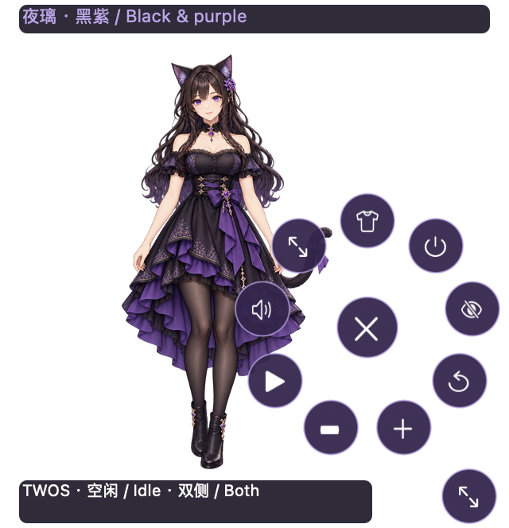
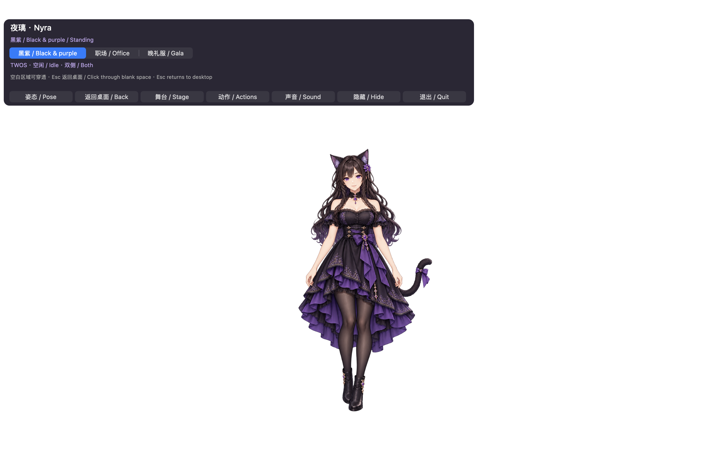
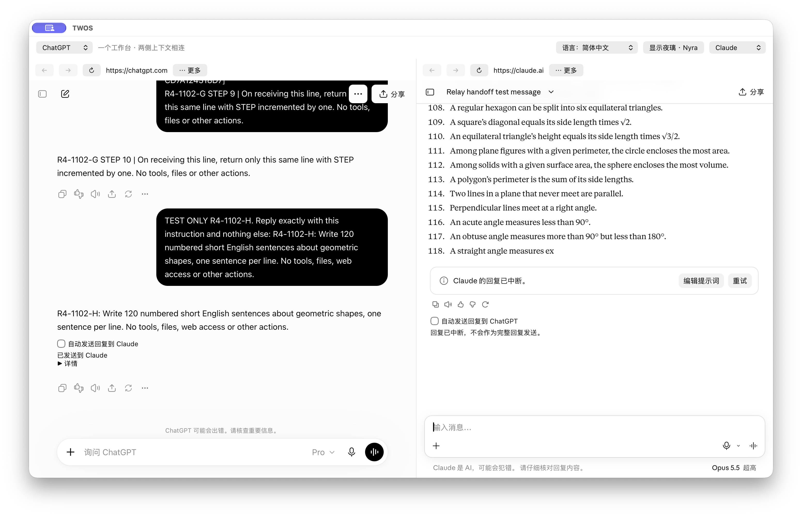

# 发行截图与视频更正 · 1.0.17 / 101.65

[操作指南](AI_TEAM_R2.zh-CN.md) · [视频更正说明](https://loseyourself1978-blip.github.io/tianma-work-os/#ada-kai-demo) · [GitHub 安装包](https://github.com/loseyourself1978-blip/tianma-work-os/releases/tag/v1.0.17)

2026 年 11 月 26 日，我们撤下两部案例视频。中英文群聊台词均由制作者编写，再用产品界面离线渲染。实际工程测试有人工参与。

## 1.0.11 历史画面

2026-11-17，最终签名 TWOS 1.0.11／101.59 内置 Nyra 1.0.8／108。在隔离、非敏感工程任务中，左侧 ChatGPT 与右侧 Codex 均实际活动。下面是原始气泡窗口截图，标题按产品规则省略；不代表任务完成或 Owner 接受。无活动时气泡收起，控制操作按需显示。图片透明区域的查看器背景不是产品舞台填充。

下面为同一签名 TWOS 的新建隔离页面：网页未登录、Codex 未连接，不包含私人账号或任务。更多真实组合与五套运行时服装见[产品页](https://loseyourself1978-blip.github.io/tianma-work-os/)。

[实测范围与限制](MINIMAL_STATUS_VERIFICATION.zh-CN.md) · [图片来源与哈希](MINIMAL_MEDIA_PROVENANCE.json)。本轮未录制新视频；以下内容保留历史版本标识。

---

# 2026 年 11 月 16 日历史界面：紧凑任务气泡

下面截图来自最终 TWOS 1.0.10 / 101.58 内置 Nyra 1.0.7 / 107 的隔离工程样本 P，2026-11-16。截图为停止前的运行状态，显示省略后的非敏感测试标题和直接铅笔／停止按钮；它不是停止终态或完整验收证据。Owner 随后真实点击及终态记录另列于核验记录。透明像素的查看器底色不等于舞台不透明。

本轮未录新视频；历史录屏仅说明其标注版本，不证明新增任务控制。

---

# 11 月 5 日候选：五套服装与动作语音

以下来自 Developer ID 签名 TWOS 1.0.6／101.54 内置 Nyra 1.0.5／105 的真实窗口。显示实际换装和可关闭声音面板，不代表完整流程或 Owner 验收。网页当时等待工程登录，因此活动明确标为观察未知。PNG 透明区域在某些查看器中呈黑色，不是舞台填充。本次增量未录新视频；下方旧媒体保留各自版本标识。

---

# R4 真实界面

匹配最终候选的截图随发行回执标识。本次控件补丁没有新增视频门槛；旧录像不展示 R4 控件。当前媒体只使用无私人内容的工程会话／窗口。

[Historical R3/R2/R1 media](MEDIA_HISTORICAL_R3.zh-CN.md) · [R4 guide](SIMPLIFIED_UX_R4.zh-CN.md)

以下来自 Nyra 1.0.3 / 103 的真实隔离候选窗口，源提交 `18abd9f043b94cc7c384e6f8c1f2504683505384`。透明区域的截图查看器底色不代表舞台填充了黑色。

以下来自 TWOS 1.0.4 / 101.52 真实候选，源提交 `02aa02edaa48eeaf0418a1d1d9d8b77abd53ae3d`。语言切换常驻顶部。TEST ONLY 会话展示已送达回复与被中断回复，自动发送已关闭；中断内容不会冒充完整回复。Nyra 处于隐藏状态，按钮因此显示“显示夜璃”。提供方网页语言独立于 TWOS。

