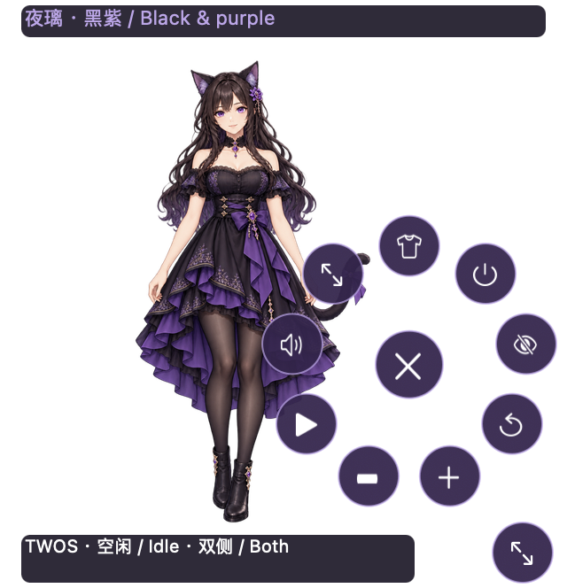
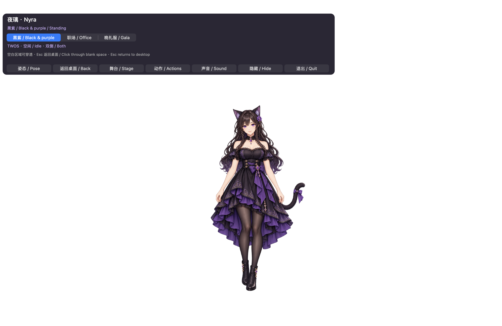
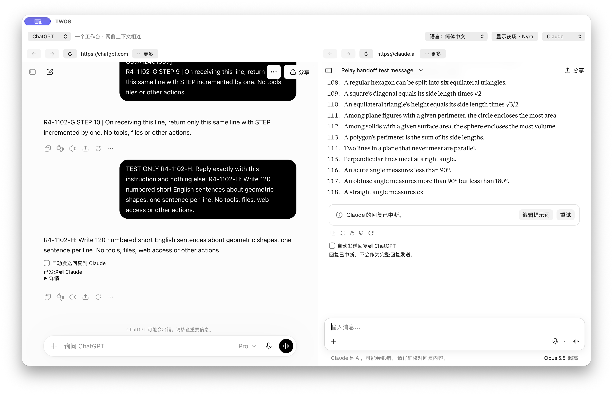

# R4 真实界面

匹配最终候选的截图随发行回执标识。本次控件补丁没有新增视频门槛；旧录像不展示 R4 控件。当前媒体只使用无私人内容的工程会话／窗口。

[Historical R3/R2/R1 media](MEDIA_HISTORICAL_R3.zh-CN.md) · [R4 guide](SIMPLIFIED_UX_R4.zh-CN.md)

以下来自 Nyra 1.0.3 / 103 的真实隔离候选窗口，源提交 `18abd9f043b94cc7c384e6f8c1f2504683505384`。透明区域的截图查看器底色不代表舞台填充了黑色。

以下来自 TWOS 1.0.4 / 101.52 真实候选，源提交 `02aa02edaa48eeaf0418a1d1d9d8b77abd53ae3d`。语言切换常驻顶部。TEST ONLY 会话展示已送达回复与被中断回复，自动发送已关闭；中断内容不会冒充完整回复。Nyra 处于隐藏状态，按钮因此显示“显示夜璃”。提供方网页语言独立于 TWOS。

