# R3 真实界面

TWOS 1.0.3 / 101.51 与 Nyra 1.0.2 / 102。以下为最终隔离候选的真实窗口，仅含 TEST ONLY 工程对话，不含 Owner 原辩论。

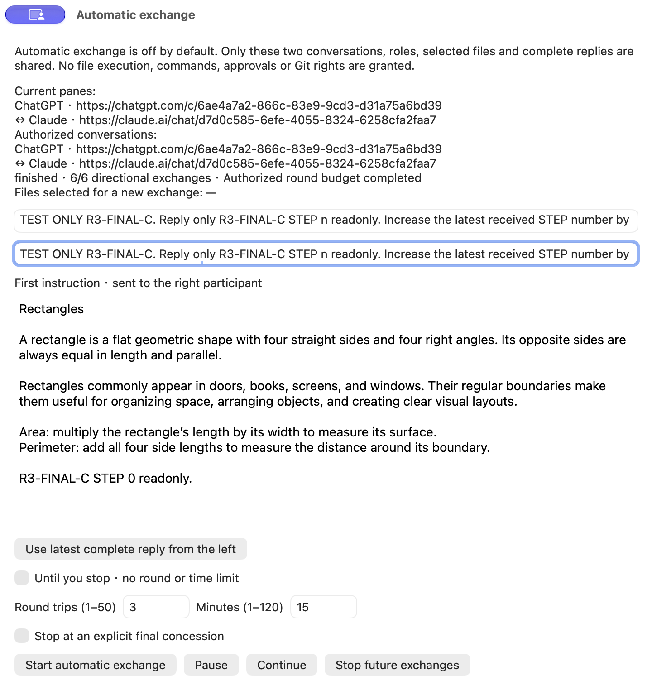

一次开始产生六次准确提交及完整回复。截图记录界面；正文 hash、停止和重启检查另有回执。

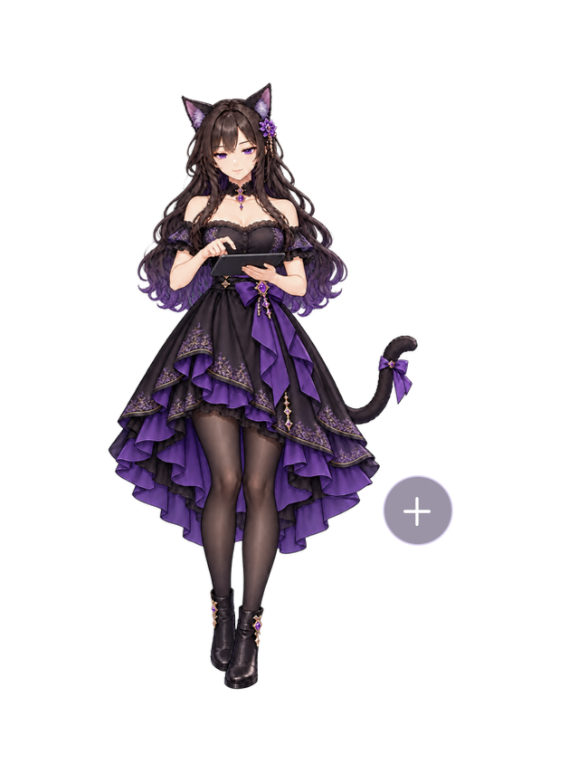

已另行观察认证 consumer 的真实 clip 与帧推进。PNG 保留透明度，查看器可能显示黑底或白底；单张截图本身不证明动画。

本轮未录新 R3 视频，以真实截图和运行观察记录本次补丁。下方旧录像仍属于历史资料。

---

# R2 实际界面 · TWOS

TWOS 1.0.2 / 构建 101.50，内置及独立 Nyra 1.0.1 / 构建 101。以下截图来自隔离的最终 Developer ID 签名候选，不含私人账号、业务历史，也不是生成的界面示意。公证和发布状态以对应发行回执为准。

## 自动互聊控制

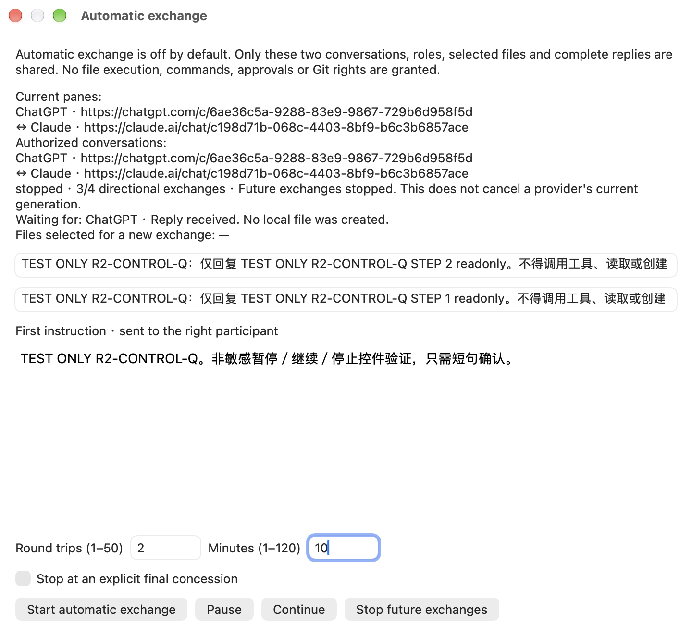

这是单独的控制验收窗口，实际显示 **stopped · 3/4**。已操作暂停、继续和停止；停止只阻止本地后续派发，不宣称取消提供方已经收到的请求。此图不是六次回复的验收回执。另一条最终候选测试已完成真实三个往返、六次精确回复，见[验证覆盖](R2_VERIFICATION.zh-CN.md)。

## 悬停舞台入口与顶部菜单

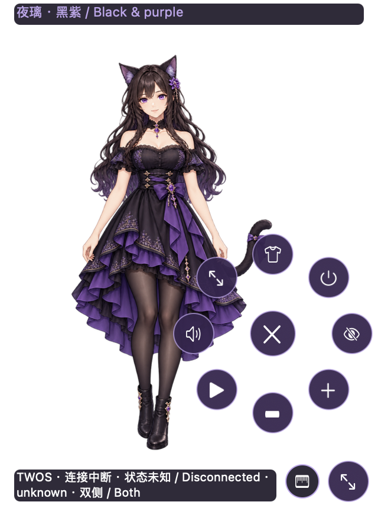

右下角舞台箭头是单击按钮，尺形缩放区是独立控件。桌面截图实际显示 **Disconnected / unknown**，用于说明中性的失联外观和控件，不作为任务已连接的证明。

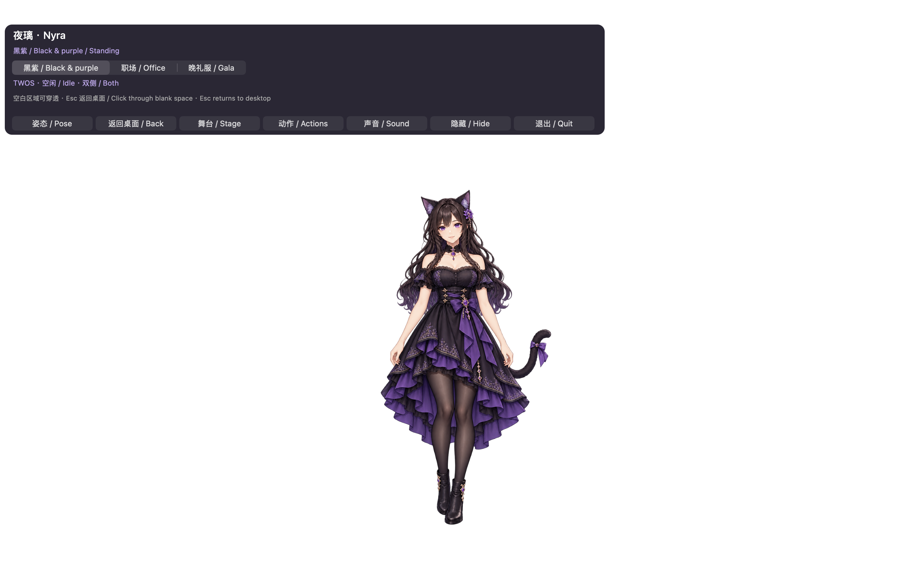

实际舞台显示顶部服装、姿态、返回、动作、声音、隐藏和退出控件。PNG 保留透明通道；查看器可能用黑色或白色显示透明区域。实际空白区域保持穿透。Wave 试播已观察到真实帧推进并恢复基础状态；真人悬停单击及此前空白穿透另有明确来源的 Owner 证据。

## 录像范围

本轮未录制新的 R2 视频，以以上真实截图和双语指南说明新增入口。下方 R1 录像仅展示此前已接受的素材和换装；旧菜单与源码身份属于历史记录，不能证明 R2 自动互聊或顶部控件已通过。

---

# 历史 R1 候选媒体 · TWOS 1.0.1 / 101.49 + Nyra 1.0.0

图片来自隔离的实际候选窗口，不含私人账号或历史，并非生成的界面示意图。截图用于说明控件及素材；动画与任务状态另有运行证据。

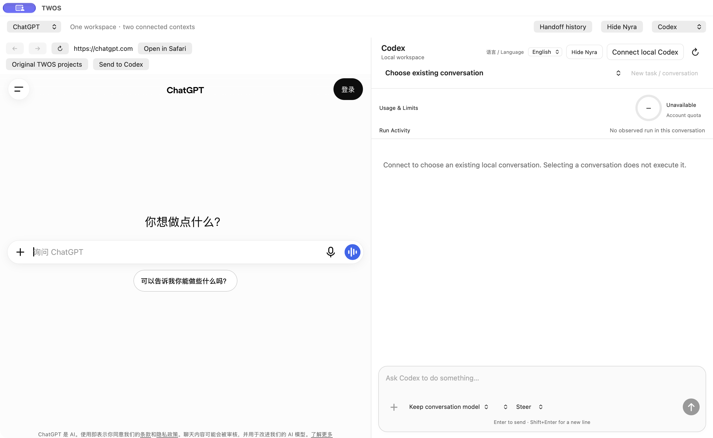

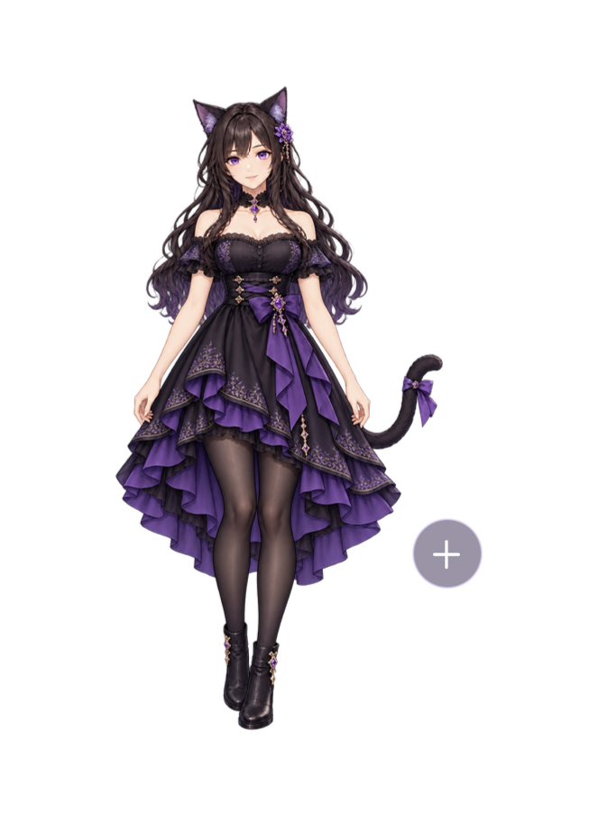

## 透明舞台的三套服装

PNG 保留透明通道，查看器可能用黑色或白色呈现空白。实际舞台透明；Owner 在空白区域真实点击隔离测试按钮后，计数增加并由接口独立读回。此结果不扩大为所有应用或显示器组合均已测试。

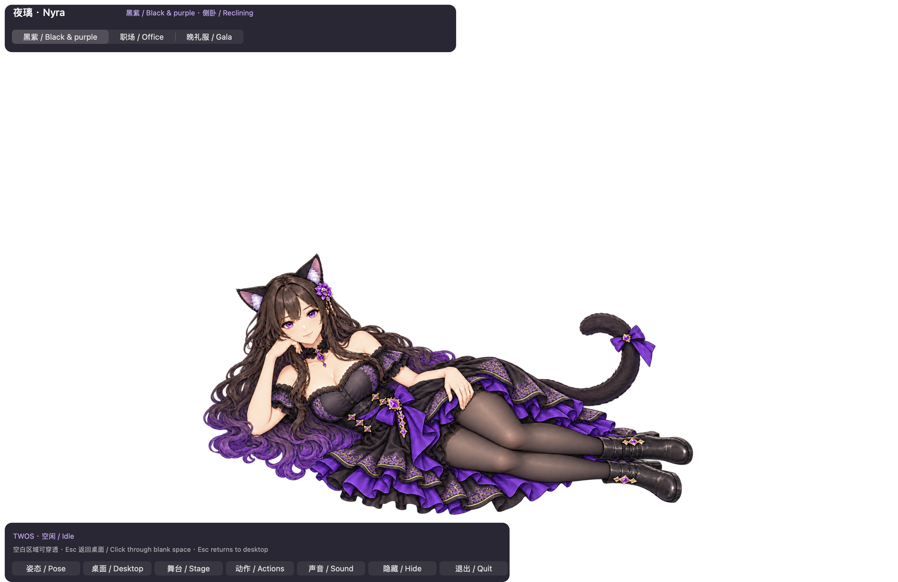
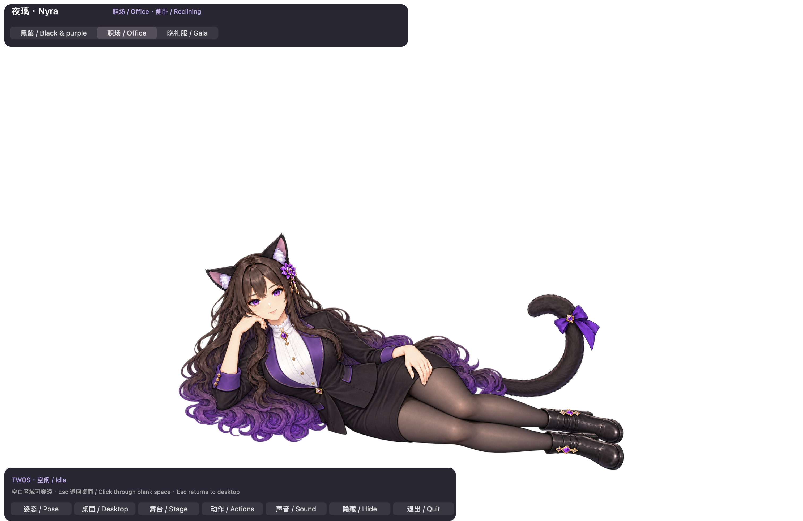
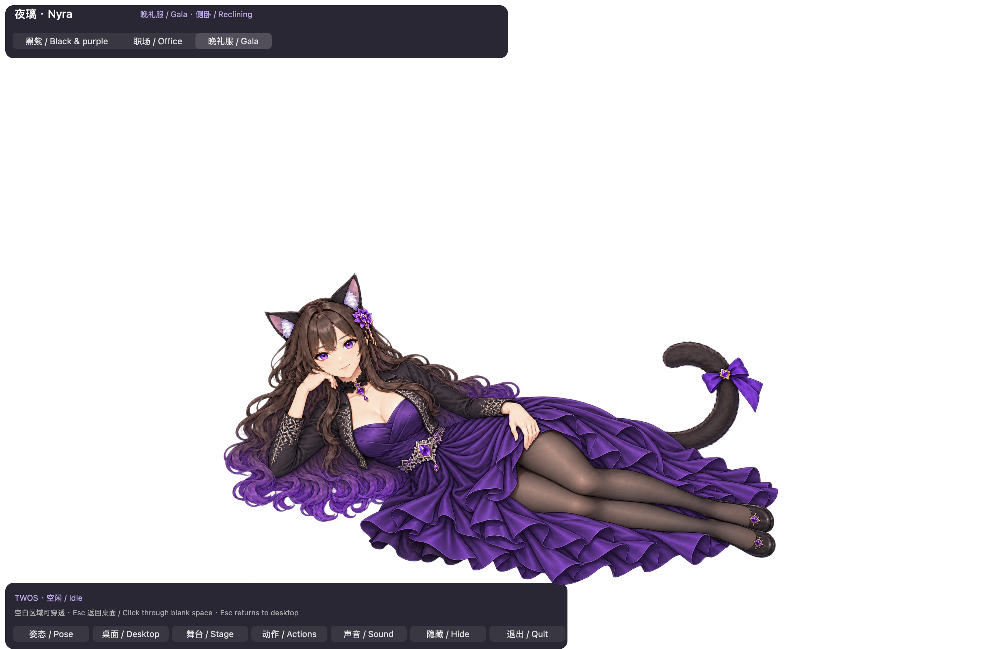

## 真实操作录像

发行媒体包含 `nyra-walkthrough.mp4`，内置可选中英文字幕，另附两份 `.srt`。按顺序剪接两段真实窗口录屏：黑紫／职场操作 70 秒，晚礼服 20 秒。不插帧，不用生成动画替代录屏。MP4 不保留透明通道，因此视频空白显示为黑色；透明性请看实际舞台及带透明通道的 PNG。

视频操作明确属于“动作试播”，不会生成模型任务或业务验收。录像展示舞台服装与控件；左右拖动、任务状态联动另有工程观察。TWOS 从安装到首次任务的完整视频为 NOT_RECORDED：授权录屏限于隔离 TWOS、Nyra 和测试窗口，没有为拍摄重复业务任务。请使用图文安装及操作指南。

二进制源码：TWOS `293e4f9a80194ea7dce1107732cb104f6d60892f`，内置 Nyra `37d8cf8a8d12cf6a6622fe8bcca663fc525659ae`。后续纯文档提交不改变这些构建输入。签名、公证与正式分发门禁由发行回执单独记录；媒体不代签 Owner 差量验收。

## 最终签名安装包复核

以下是最终签名、公证包内 Nyra 的实际隔离窗口，未含私人资料。最终 TWOS 同时实际读回原工程任务并打开 `status-check.txt`；未为截图新增模型调用。该任务窗口的完整截图仅保留在本机验证证据，因为背景含账户遥测。

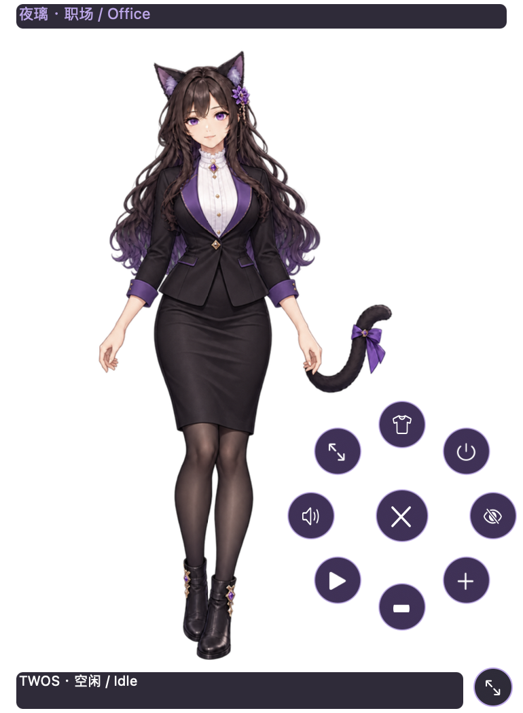
