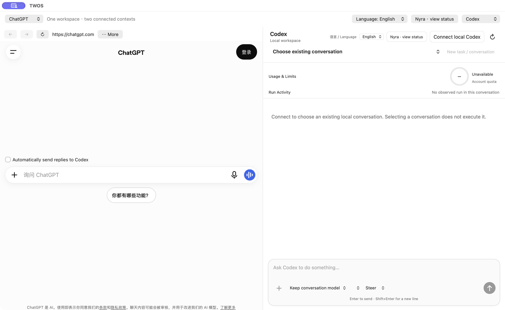

# TWOS 1.0.9 / 101.57 — Website address repair

The Owner reported that selecting **Website…**, entering a private-network HTTP address and clicking **Open** silently closed the address dialog on either side. In the installed 1.0.8 baseline, input validation accepted HTTP only on the local computer. The rejected address was handled like Cancel, before any WebKit navigation.

The development fix keeps the address sheet open with a specific reason when an address is rejected. It accepts HTTPS, local-computer HTTP, and explicit RFC 1918 IPv4 HTTP addresses (10.x.x.x, 172.16–31.x.x, 192.168.x.x). Unencrypted HTTP navigation is limited to the exact selected host and port. No model task, cross-pane send, site operation, credential transfer, or global security exception is implied by opening a page.

Choose **Website…** on the intended side → enter the complete address including `http://` or `https://` and the port if needed → **Open**. Check the displayed origin and loaded page. Cancel preserves the original pane. An invalid address stays editable. A network failure shows a retry notice; successful loading clears that notice. An explicit new address takes precedence over an older saved location on that host.

Addresses containing credentials, query parameters or fragments remain unsupported in the initial address sheet; the specific reason is displayed. Open the site without those parts and navigate within it. Public HTTP and non-HTTP(S) schemes remain blocked. This does not add automated handoff to arbitrary websites.

Status: signed, notarized and validated. The matching GitHub Release determines public download availability. Owner acceptance is not implied.

## Matching validation

The matching signed package passed one complete serial gate: 1865 passed, 1 existing historical skip, 0 failures, including 38 real Safari measurements. Actual final-DMG UI checks cover both panes, explicit local/private HTTP navigation, editable invalid-input feedback, Cancel and saved state. No model task or old business execution was started for this repair. The preceding Codex connection repair and Nyra 1.0.6 / 106 remain unchanged. Owner acceptance is separate.

## Actual starting workspace

Final-DMG window: signed-out websites and disconnected Codex. No private page or conversation is pictured. This is a starting-state image, not a task-success receipt.
