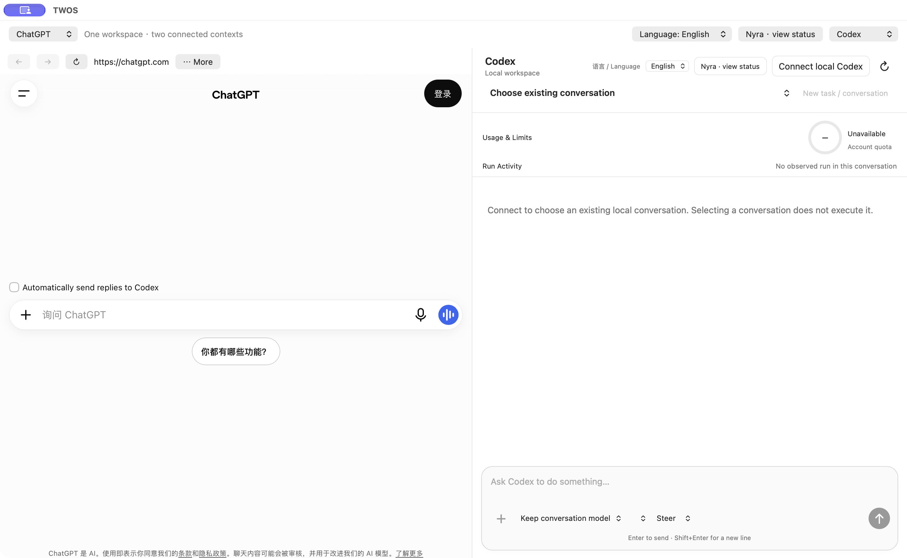

# TWOS 1.0.9 / 101.57 — 网页地址修复

Owner 报告：左右任一侧选择“网页…”，输入局域网 HTTP 地址，点击“打开”后输入框关闭但页面不变。已安装的 1.0.8 基线只接受本机 HTTP；无效地址被当作取消处理，尚未发起 WebKit 导航就静默返回。

本次修复在拒绝地址时保留输入框并显示具体原因。支持 HTTPS、本机 HTTP，以及明确输入的 RFC 1918 私有 IPv4 HTTP 地址（10.x.x.x、172.16–31.x.x、192.168.x.x）。未加密的 HTTP 导航仅限选定的确切主机和端口。打开页面不启动模型、不跨栏发送、不操作网站数据、不搬运凭据，也不添加全局安全例外。

在目标侧选择“网页…” → 输入包含 `http://` 或 `https://` 的完整地址及必要端口 →“打开”→ 核对地址栏和实际页面。取消保留原面板；无效地址留在原处供修改。网络失败显示重试提示，成功加载后清除该提示。本次明确输入的地址优先于同主机过去保存的位置。

初始输入框仍不接受含用户名/密码、查询参数或片段的地址，并会说明原因；可先打开去掉这些部分的站点，再在站内导航。公共 HTTP 与非 HTTP(S) 协议仍被阻止。这不代表任意网站新增了自动交接能力。

状态：已签名、公证并完成验证；公开下载是否可用以对应 GitHub Release 的实际状态为准。不代签新的 Owner 接受。

## 匹配验证

匹配签名包完成同一批串行完整回归：1865 通过、1 项既有历史跳过、0 失败，含 38 项真实 Safari 测量。最终 DMG 的实际界面检查覆盖左右侧、明确本机／私网 HTTP 导航、无效输入可编辑提示、取消和保存状态。本次修复未启动模型任务或重放旧业务；原 Codex 连接修复及 Nyra 1.0.6 / 106 保持不变。Owner 接受另行记录。

## 实际起始工作台

最终 DMG 窗口：网页未登录、Codex 未连接。图中没有私人页面或聊天；起始状态截图不代表业务执行成功。
